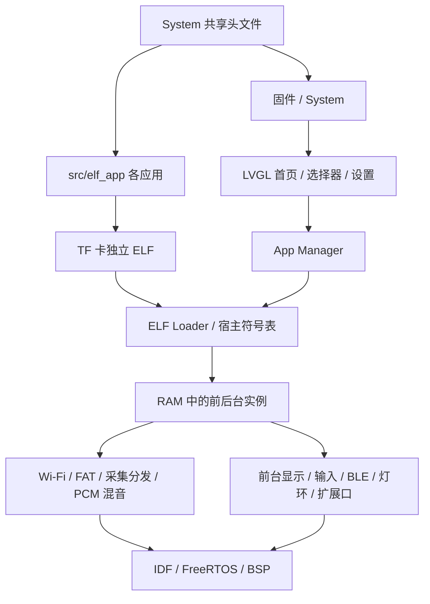

# T-Embed 软件平台实现计划

System 常驻 ESP32-S3 固件，可信应用与固件共享地址空间、头文件、编译器和配置。在 `src/elf_app/<id>` 登记的应用各自产生 ELF，随构建生成 TF 卡目录。设置内置，未插卡也能进入。SDK 接口变化后重新构建对应 ELF。



## 驱动与调度方案

|资源|实现与所有权|
|---|---|
|电源、电池、背光|GPIO46 上电保持，GPIO4 ADC oneshot 校准与二倍分压，GPIO15 LEDC。设置保存亮度和总音量。|
|ST7789、旋钮|SPI2 DMA，320×170 RGB565 局部双缓冲，LVGL 9 与 esp_lvgl_port。前台使用独立 LVGL 容器或提交像素块。GPIO2/1 编码器，GPIO0 短按选择、长按回首页。|
|TF|SPI3 SDSPI、FatFs、VFS 挂载 `/sdcard`。IO38/40/41 与扩展口互斥。挂载失败保留数据，格式化二次确认，停止应用并关闭文件后操作。|
|ES7210|板内 SDA18/SCL8，I2S1 RX 使用 47/21/14/48。esp_codec_dev 配置芯片，16 kHz 单声道 16-bit PCM，各订阅者独立读游标。|
|扬声器|I2S0 TX 使用 7/5/6，48 kHz 单声道。每路有界队列、增益、缺帧补零，10 ms 帧混音和饱和输出。|
|网络|System 管理 STA 和 SNTP，应用直接用 socket、POSIX 文件接口。前台 NimBLE 扫描、连接、绑定管理。|
|灯环、扩展口|7 颗 APA102，GPIO45/42 软件时钟。按前台实例登记，退后台恢复默认状态。|

## 实施顺序和验收

1. 建立可复现的 16 MB Flash、8 MB OPI PSRAM 配置，划分固件与 NVS 分区。上板验证四角图、颜色、调光、旋钮方向和电池电压。
2. 一次构建固件和独立 ELF，生成清单、兼容标识和宿主导出表。从 TF 加载至 RAM，拒绝损坏、不匹配及内存不足的程序。记录加载峰值。
3. 前后台切换时释放独占资源，后台维持网络、文件、录放音。停止时排空任务与回调再卸载，失败保留镜像。两份 ELF 同驻验证混音与采集。
4. 首页显示时间、日期、电压、后台数、RAM 与存储占用。选择器可启动、恢复和停止应用。内置设置管理 Wi-Fi、BLE、文件、格式化、音量、亮度和电池。检查无卡恢复流程。
5. 真机联合压力测试 30 分钟、100 次切换及装卸。记录最大连续堆、任务与流数、丢帧、加载峰值和面板偏移。

## 构建与部署

在 ESP-IDF 6.1.1 环境中执行以下命令。组件版本在 `src/dependencies.lock` 固定。

```sh
cd src
idf.py build
python3 tools/check_packages.py
```

构建产出 `build/kira-lilygo.bin` 和 `build/sdcard/apps/{scope,tone}/`。连接板卡后用 `idf.py -p PORT flash monitor` 烧写固件。将 `build/sdcard/` 的内容复制到 FAT 格式 TF 卡根目录。每次发布一起复制应用清单与 ELF，清单里的 SHA-256 对应本次固件的 ELF，启动时与 Flash 镜像的应用描述符进行核对。

首页短按打开选择器，旋转选中应用，再短按启动。长按 800 ms 回首页，选择器里的 `Stop` 结束后台应用。`Scope` 绘制麦克风波形，`Tone` 播放 440 Hz 测试音，短按可静音。设置里的 Wi-Fi 密码编辑器通过旋转选字符、按下录入，`[Delete]` 删除，`[Done]` 提交。文件管理中的目录删除只作用于空目录。格式化在容量查询工作任务中执行，期间界面保持刷新。

## 添加同仓库应用

1. 复制 `src/elf_app/tone/` 为新目录，让 `manifest.json` 的 `id` 与目录名一致。设置 `name`、`background`，在该目录的 CMake 中调用 `t_embed_app(id 源文件...)`，并在上级 CMake 登记 `add_subdirectory(id)`。
2. 入口签名为 `extern "C" int app_main(int argc, char **argv)`。`argv[0]` 是宿主分配的 `embed::App*`。入口填写生命周期函数指针，返回后由 System 调度。应用包含 System 的 `platform.hpp` 和所需组件的头文件，C/C++ 函数和数据按真实链接名导出。固件链接会报告找不到的定义。
3. `foreground` 在系统 UI 任务内创建控件，`root` 与 `focus` 只在本次前台期间有效。`background` 释放应用自己登记的前台事件源。System 随后删除根容器、焦点组、像素画布，并归还灯环与引脚。每次恢复前台都重新创建控件。像素提交函数会在返回前复制数据。
4. `tick` 是前后台可用的短时合作回调。长时间网络、文件操作可直接创建 FreeRTOS 任务。应用的 `stop` 回调在工作任务里取消自行注册的事件源、等待任务退出、关闭文件与 socket，然后返回 `true`。System 等待最多 100 ms，超时保持镜像，停止投递 tick 并阻止格式化。回调完成后在选择器再次选择停止，即可回收镜像。直接使用 IDF/LVGL 创建的回调和工作线程由创建方清理。
5. 音频 API 以 10 ms 帧工作。`capture` 输出 160 个 `int16_t` 和当前读者丢帧数，`play` 接收 480 个 `int16_t`。系统预分配 4 个 App 流槽，每个播放队列容纳 3 帧，采集历史为 8 帧。混音使用 32 位整数累加、分轨和总音量、16 位饱和输出。实时路径直接处理 PCM，实际余量通过真机联测记录。

## 验证记录

- ESP-IDF 6.1.1 交叉编译和最终固件链接通过。两个应用分别生成 Xtensa ELF，应用代码位于卡上，宿主包含按需生成的符号表。
- `tools/check_packages.py` 比对实际固件映像中的构建标识，使用乐鑫 Xtensa 校验器检查两个完整 ELF 和截断输入。主机测试使用固件符号地址，在乐鑫流式重定位实现中同时装入两个包，重复装卸 100 次并核对分配回收，还覆盖缺符号和分配失败。
- 真机验收待接入标准 T-Embed 板卡。重点记录整机冷启动、PSRAM 指令执行、TF 热拔与重新挂载、ST7789 方向和偏移、ES7210 有效声道、电池电压误差、BLE 与 Wi-Fi 并行、30 分钟录放音及 100 次前后台切换。格式化验收使用可清空的测试卡。
